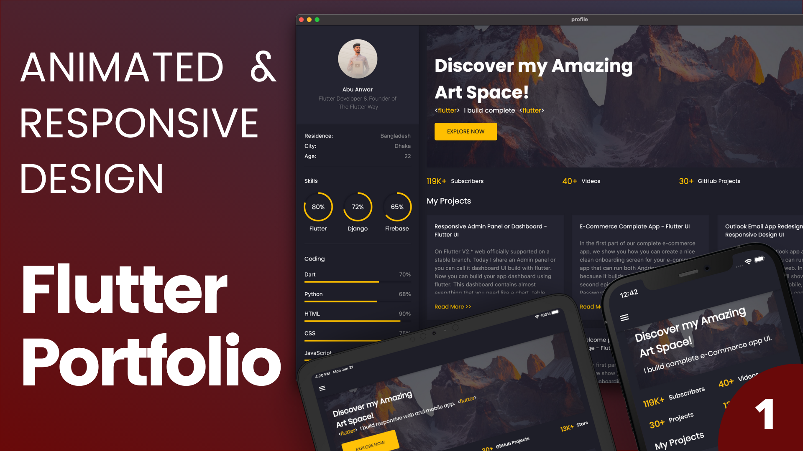

# Portfolio Website (Flutter Web)

My first portfolio site, written in Flutter for the web in 2022. It has been replaced by my current portfolio at [rohanjariwala.web.app](https://rohanjariwala.web.app), so this repo is kept for reference.



## What's on the page

- A side panel with my photo, name and role, animated progress indicators for skills (circular) and languages (bars), a list of other tools I know, a "Download CV" button and LinkedIn/GitHub links. On desktop it sits on the left. Below 1024px it moves into a drawer opened from the app bar.
- A banner with a typewriter-style line cycling through the languages I've worked with.
- A grid of project cards that link to the GitHub repos.
- A work experience section.

All content is hardcoded. Projects live in `lib/models/Project.dart` and experience in `lib/models/Experience.dart`. There are also highlights (animated counters) and recommendations sections in the code, but they're commented out in `home_screen.dart`.

## Stack

- Flutter (web)
- google_fonts (Poppins), flutter_svg, animated_text_kit, url_launcher

## Running it

```shell
git clone https://github.com/rohanjariwala03/portfolio_website_flutter.git
cd portfolio_website_flutter
flutter pub get
flutter run -d chrome
```

`flutter build web` produces the static site in `build/web`.

This was built in 2022 on Flutter 2.x (the lockfile needs Flutter 2.10 or later) and doesn't compile on current Flutter. It uses `TextTheme` names like `bodyText1`, `subtitle2` and `headline3` that were removed in later releases. The side menu also imports `dart:html`, so it only builds for web.

The "Download CV" button opens `assets/resume/Resume_Rohan.pdf` from the site root, but that folder isn't listed under `assets` in `pubspec.yaml`, so the PDF has to be copied into the build output by hand for the link to work.

## Project layout

```
lib/
  main.dart            app entry, dark theme with Poppins
  constants.dart       colors, padding, max width
  responsive.dart      mobile / tablet / desktop breakpoints
  models/              project, experience and recommendation data
  components/          animated counter and progress indicators
  screens/main/        page shell and the side menu
  screens/home/        banner, projects, experience
```
